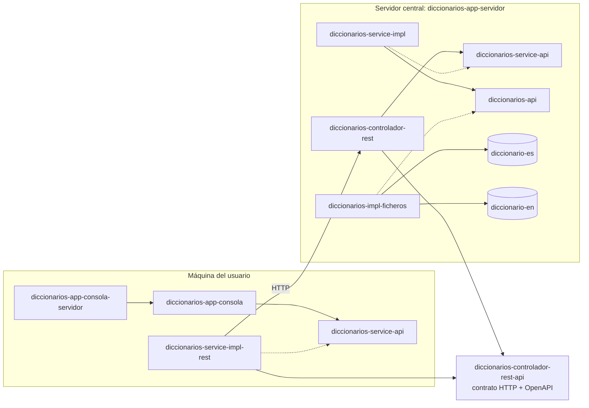

# Diccionario · v2.0: Servidor central

> Rama `v2.0-servidor-central`. El proyecto evoluciona rama a rama, y cada una compila, pasa sus
> pruebas y funciona:
>
> `v1.0-consola-ficheros` → `v1.1-control-de-configuracion` → `v1.2-repositorio-que-avisa-de-errores` → **`v2.0-servidor-central`** ← estás aquí → `v3.0-bbdd` → `v3.1-sugerencias` → `v4.0-frontal-web`

Busca una palabra en el diccionario de un idioma y muestra sus significados con ejemplos.

```
$ buscarPalabra es MELON
La palabra melón existe en el idioma ES y tiene los siguientes significados:
- Fruto grande, redondo y de pulpa jugosa y dulce.
    Ej: Me gusta comer melón!
- Persona con pocas luces.
    Ej: Eres un melón
    Ej: No seas melón
```

## Qué trae esta versión

**Arquitectura distribuida, cliente-servidor.** Para qué: que los cambios en las palabras, y en
**cómo** se usan los diccionarios (el servicio), no obliguen a actualizar todas las máquinas.

**No hay que cambiar nada del código.** Solo se crean componentes nuevos:

- `diccionarios-controlador-rest-api`: el **contrato HTTP**, independiente, del que springdoc genera
  la especificación **OpenAPI**. Se escribe una sola vez (DRY).
- `diccionarios-controlador-rest`: expone por REST las funciones del servicio, en el backend.
- `diccionarios-service-impl-rest`: otra implementación del mismo `BuscadorDePalabras`, que traduce
  cada llamada al API Java en una petición HTTP (`java.net.http.HttpClient`, Java 11).
- `diccionarios-app-servidor`: el servidor (Spring Boot). Las **factorías** de la consola se
  convierten en **`@Bean`**: aquí el `new` lo hace Spring (inversión de control), y estos métodos le
  dicen de dónde sale cada pieza (inyección de dependencias).
- `diccionarios-app-consola-servidor`: otra aplicación, otro ensamblado **del mismo código** de
  consola: con el servicio remoto en vez del local.

Y en paralelo sigue estando `diccionarios-app-consola-ficheros`, 100 % local. Las probabilidades de
estropear algo son bajas: no se ha tocado nada de lo que ya funcionaba, y lo nuevo se prueba a
fondo. El servicio remoto pasa **las mismas pruebas de contrato** que el local, contra el servidor de
verdad.

```bash
git diff v1.2-repositorio-que-avisa-de-errores v2.0-servidor-central --stat   # solo ficheros nuevos, y el pom raíz
```

Siguiente: `v3.0-bbdd`.

## Requisitos

- JDK 21 o superior (se compila con `release 21`; probado con JDK 25).
- Maven no hace falta: va el wrapper (`./mvnw`).

## Arquitectura



Y en paralelo, `diccionarios-app-consola-ficheros`, todo en la máquina del usuario, como en la `v1.0`.

### Componentes

Cada componente versiona por su cuenta: el número cambia solo cuando cambia él. La tercera
columna dice qué ha cambiado respecto a la rama anterior.

| Componente | Versión | | Qué es |
|---|---|---|---|
| `diccionarios-api` | 1.1.0 |  | El REPOSITORIO (lógica de persistencia): `SuministradorDeDiccionarios`, `Diccionario`, `Significado`. Funciones de bajo nivel, casi un SELECT. Con sus pruebas de contrato (`test-jar`) |
| `diccionarios-impl-ficheros` | 1.1.0 |  | El repositorio en ficheros: lee los `.txt` de los jars de idioma |
| `diccionario-es` | 1.1.0 |  | Solo datos: el diccionario de español y su índice |
| `diccionario-en` | 1.0.1 |  | Solo datos: el diccionario de inglés y su índice |
| `diccionarios-service-api` | 1.0.0 |  | El SERVICIO (lógica de negocio): `BuscadorDePalabras` y su resultado sellado `ResultadoDeBusqueda` (`PalabraEncontrada`, `PalabraNoEncontrada`, `IdiomaNoSoportado`) |
| `diccionarios-service-impl` | 1.1.0 |  | El servicio de verdad, sobre el repositorio. Con las pruebas de contrato del servicio (`test-jar`) |
| `ui-api` | 1.0.0 |  | La interfaz de usuario: todo lo que la app le dice o le pide al usuario |
| `ui-impl-consola` | 1.0.1 |  | La de línea de comandos: lee idioma y palabra de los argumentos |
| `diccionarios-app-consola` | 1.0.0 |  | El código de la app de consola: el `main`, las **factorías** y `ProcesadorDePeticiones`, que expone el servicio por la línea de comandos |
| `diccionarios-app-consola-ficheros` | 1.2.0 |  | LA APLICACIÓN, el ensamblado: un pom sin código que dice qué piezas lleva. Todo en local, con ficheros |
| `diccionarios-controlador-rest-api` | 1.0.0 | **nuevo** | El contrato HTTP, independiente: rutas, DTO, errores, y la especificación OpenAPI que se genera de él |
| `diccionarios-controlador-rest` | 1.0.0 | **nuevo** | El `@RestController`: expone el servicio por HTTP |
| `diccionarios-service-impl-rest` | 1.0.0 | **nuevo** | Otro servicio... que se lo pregunta al servidor por HTTP (`java.net.http`): traduce llamadas al API Java en peticiones REST |
| `diccionarios-app-consola-servidor` | 1.0.0 | **nuevo** | Otra aplicación, otro ensamblado del mismo código: la consola contra el servidor |
| `diccionarios-app-servidor` | 1.0.0 | **nuevo** | La aplicación del servidor (Spring Boot): las factorías convertidas en `@Bean` |

## Comandos

Todo desde esta carpeta (`proyectos/diccionario`). Con el **Maven wrapper** no hace falta tener
Maven instalado: `./mvnw` (en Windows, `mvnw.cmd`) se baja la versión que toca la primera vez.

```bash
./mvnw install                 # todo: compila, pasa las pruebas y deja los jars en target/ y en ~/.m2
./mvnw install -DskipTests     # lo mismo sin pruebas
./mvnw verify                  # pruebas + informe de cobertura (target/site/jacoco/index.html de cada módulo)
```

> `mvn clean` borra el `target/` de un proceso que esté corriendo (el servidor, por ejemplo): la
> JVM sigue viva pero no puede cargar clases nuevas y deja de responder sin decir nada. Reinícialo
> después de cada `clean`.

### La consola, todo en local: `diccionarios-app-consola-ficheros`

```bash
./mvnw install -DskipTests
./mvnw exec:exec -pl diccionarios-app-consola-ficheros -Dargumentos="es MEMBRILLO"
```

Con `java` directamente (después de `./mvnw package`), con las piezas que dice su pom:

```bash
java --module-path diccionarios-api/target/diccionarios-api-1.1.0.jar:diccionarios-service-api/target/diccionarios-service-api-1.0.0.jar:diccionarios-service-impl/target/diccionarios-service-impl-1.1.0.jar:ui-api/target/ui-api-1.0.0.jar:ui-impl-consola/target/ui-impl-consola-1.0.1.jar:diccionarios-impl-ficheros/target/diccionarios-impl-ficheros-1.1.0.jar:diccionario-es/target/diccionario-es-1.1.0.jar:diccionario-en/target/diccionario-en-1.0.1.jar:diccionarios-app-consola/target/diccionarios-app-consola-1.0.0.jar \
     --add-modules ALL-MODULE-PATH \
     --module app/com.curso.diccionario.app.consola.BuscarPalabra es MEMBRILLO
```

- `--add-modules ALL-MODULE-PATH`: las implementaciones y los diccionarios no los requiere ningún
  módulo (se encuentran por el `ServiceLoader` y por el class loader), y un módulo que nadie
  requiere no se carga.
- Quitar un idioma es quitar su jar del module path. No hay nada más que configurar.
- Con `DICCIONARIOS_CARPETA=/ruta/` se leen los `<idioma>.txt` de una carpeta del disco.
- En Windows el separador del *module path* es `;` en lugar de `:`.

### El servidor: `diccionarios-app-servidor`

```bash
java -jar diccionarios-app-servidor/target/diccionarios-app-servidor-1.0.0.jar
```

- API: `http://localhost:8080/api/v1/diccionarios`
- Swagger UI: `http://localhost:8080/swagger-ui.html`
- Especificación OpenAPI: `http://localhost:8080/v3/api-docs`, y al empaquetar,
  `diccionarios-controlador-rest-api/target/openapi.yaml`

| Petición | Respuesta |
|---|---|
| `GET /api/v1/diccionarios` | 200 con los idiomas: `["EN","ES"]` |
| `GET /api/v1/diccionarios/{idioma}` | 200 `{"idioma":"ES"}`, o 404 `IDIOMA_NO_DISPONIBLE` |
| `GET /api/v1/diccionarios/{idioma}/palabras/{palabra}` | `buscarExacta`: 200 con la palabra y sus significados, o 404 `IDIOMA_NO_DISPONIBLE` / `PALABRA_NO_ENCONTRADA` |
| `GET .../palabras/{palabra}?ignorarMayusculasYAcentos=true` | `buscarIgnorandoMayusculasYAcentos`: "Atun" devuelve "atún" |
| cualquiera | 500 `ERROR_INTERNO` si algo falla, sin detalles internos |

Los dos 404 se distinguen por el campo `codigo` del cuerpo, no por el status.

### La consola contra el servidor: `diccionarios-app-consola-servidor`

Con el servidor arrancado. Ni lógica de negocio, ni repositorio, ni diccionarios en la máquina del
usuario: solo el servicio remoto.

```bash
./mvnw exec:exec -pl diccionarios-app-consola-servidor -Dargumentos="es Atun"
```

```bash
java --module-path diccionarios-api/target/diccionarios-api-1.1.0.jar:diccionarios-service-api/target/diccionarios-service-api-1.0.0.jar:ui-api/target/ui-api-1.0.0.jar:ui-impl-consola/target/ui-impl-consola-1.0.1.jar:diccionarios-service-impl-rest/target/diccionarios-service-impl-rest-1.0.0.jar:diccionarios-controlador-rest-api/target/diccionarios-controlador-rest-api-1.0.0.jar:$HOME/.m2/repository/com/google/code/gson/gson/2.14.0/gson-2.14.0.jar:diccionarios-app-consola/target/diccionarios-app-consola-1.0.0.jar \
     --add-modules ALL-MODULE-PATH \
     --module app/com.curso.diccionario.app.consola.BuscarPalabra es Atun
```

El servidor, en `DICCIONARIOS_SERVIDOR` (por defecto `http://localhost:8080`).

## Los diccionarios

Un jar por idioma (`diccionario-es`, `diccionario-en`), con dos ficheros en `META-INF/diccionarios/`:

- `<idioma>.txt`, en UTF-8, una línea por palabra:

  ```
  palabra=significado1(ejemplo1)(ejemplo2)|significado2(ejemplo1)|significado3
  ```

  Los caracteres `=`, `|`, `(` y `)` están reservados: el formato no los escapa.

- `idiomas`: el código del idioma (`ES`). Dentro de un jar no se puede listar una carpeta, pero
  `ClassLoader.getResources` (en plural) devuelve **todos** los `idiomas` del classpath: los idiomas
  disponibles son, por construcción, los jars que hay.

Cada uno tiene unas pocas palabras reales escritas a mano y **5000 inventadas**, las mismas en los
dos idiomas: no hay de dónde sacar 5000 palabras reales con definición y traducción con licencia
para copiarlas. Las genera, siempre iguales, `herramientas/GeneradorDeDiccionarios.java`.

## Cómo evolucionan los API

| Versión | Qué cambia | Por qué es un minor |
|---|---|---|
| repositorio 1.1.0 (`v1.2`) | Métodos nuevos con `throws Exception` y `default` que delega en el viejo; los viejos, `@Deprecated(forRemoval = true)` | Las implementaciones existentes siguen compilando sin tocarlas |

Los deprecados se quedan a propósito: quitarlos rompería a quien los use y sería un **major**.

## Pruebas

| Dónde | Qué prueban |
|---|---|
| `diccionarios-api` | El **contrato del repositorio**: lo que cualquier implementación tiene que cumplir (`test-jar`). Lo cumple una implementación de referencia en memoria |
| `diccionarios-impl-ficheros` | El contrato del repositorio, con ficheros generados; el formato; la lectura del classpath y del índice |
| `diccionarios-service-impl` | El **contrato del servicio** (`test-jar`): las dos búsquedas, la ñ, los tres resultados; las reglas de normalización; que un error del repositorio llega como `BuscadorDePalabrasException` |
| `diccionarios-service-impl-rest` | Contra un servidor falso (`com.sun.net.httpserver`, del JDK): cada 404, 500, un 404 que no es nuestro, URL mal codificada, servidor caído |
| `diccionarios-controlador-rest` | Las URLs, status y JSON del controlador con `@WebMvcTest`, con un servicio falso |
| `diccionarios-app-servidor` | Que arranca y sirve los idiomas; y **el servicio remoto cumple el contrato del servicio contra este servidor de verdad** |
| `ui-impl-consola`, `diccionarios-app-consola` | Los mensajes de la consola; el procesador con un servicio y una interfaz de usuario falsos, sin capturar la consola |

## Limitaciones conocidas

- **Diccionarios de mentira.** Las 5000 palabras de cada idioma son inventadas, y se nota.
- **Sin acentos, si dos palabras se escriben igual** (*papa* y *papá*) y se busca *PAPA*, se encuentra la primera en orden alfabético. La exacta no tiene ese problema.
- **Solo module path** para las apps de consola: en el classpath el `ServiceLoader` no usa los `provides` de `module-info`.

## Novedades de Java 8+ en este código

Lo que este código usa de cada versión LTS (y de las intermedias que llegaron a ellas). En el
código, cada una está marcada la primera vez que aparece en cada fichero con un comentario
`// Java N: ...` que dice qué es; aquí, dónde mirar y la referencia oficial (el JEP de OpenJDK que
la introdujo o, si no tiene, su Javadoc).

| Versión | Novedad | Referencia | Dónde se usa |
|---|---|---|---|
| Java 8 | Expresiones lambda | [JEP 126](https://openjdk.org/jeps/126) | [BuscadorDePalabrasFactory.java:22](diccionarios-app-consola/src/main/java/com/curso/diccionario/app/consola/factorias/BuscadorDePalabrasFactory.java#L22), [InterfazDeUsuarioFactory.java:20](diccionarios-app-consola/src/main/java/com/curso/diccionario/app/consola/factorias/InterfazDeUsuarioFactory.java#L20), [ConfiguracionDeDiccionarios.java:36](diccionarios-app-servidor/src/main/java/com/curso/diccionario/app/servidor/ConfiguracionDeDiccionarios.java#L36), y 6 más |
| Java 8 | Referencias a método (`::`) | [JEP 126](https://openjdk.org/jeps/126) | [ControladorRestDiccionarios.java:77](diccionarios-controlador-rest/src/main/java/com/curso/diccionario/controlador/rest/ControladorRestDiccionarios.java#L77), [CatalogoDeDiccionariosEnClasspath.java:45](diccionarios-impl-ficheros/src/main/java/com/curso/diccionario/impl/ficheros/formato/CatalogoDeDiccionariosEnClasspath.java#L45) |
| Java 8 | Streams (`stream`, `map`, `filter`, `parallelStream`...) | [JEP 107](https://openjdk.org/jeps/107) | [ControladorRestDiccionarios.java:77](diccionarios-controlador-rest/src/main/java/com/curso/diccionario/controlador/rest/ControladorRestDiccionarios.java#L77), [SuministradorDeDiccionariosDesdeFicheros.java:104](diccionarios-impl-ficheros/src/main/java/com/curso/diccionario/impl/ficheros/SuministradorDeDiccionariosDesdeFicheros.java#L104), [CatalogoDeDiccionariosEnClasspath.java:41](diccionarios-impl-ficheros/src/main/java/com/curso/diccionario/impl/ficheros/formato/CatalogoDeDiccionariosEnClasspath.java#L41), y 3 más |
| Java 8 | `Optional` | [`Optional`](https://docs.oracle.com/en/java/javase/21/docs/api/java.base/java/util/Optional.html) | [Diccionario.java:29](diccionarios-api/src/main/java/com/curso/diccionario/api/Diccionario.java#L29), [SuministradorDeDiccionarios.java:36](diccionarios-api/src/main/java/com/curso/diccionario/api/SuministradorDeDiccionarios.java#L36), [ProcesadorDePeticiones.java:34](diccionarios-app-consola/src/main/java/com/curso/diccionario/app/consola/ProcesadorDePeticiones.java#L34), y 7 más |
| Java 8 | Métodos `default` en interfaces | [JEP 126](https://openjdk.org/jeps/126) | [Diccionario.java:22](diccionarios-api/src/main/java/com/curso/diccionario/api/Diccionario.java#L22), [SuministradorDeDiccionarios.java:19](diccionarios-api/src/main/java/com/curso/diccionario/api/SuministradorDeDiccionarios.java#L19) |
| Java 8 | `Map.computeIfAbsent` | [`Map.computeIfAbsent`](https://docs.oracle.com/en/java/javase/21/docs/api/java.base/java/util/Map.html#computeIfAbsent(K,java.util.function.Function)) | [SuministradorDeDiccionariosDesdeFicheros.java:157](diccionarios-impl-ficheros/src/main/java/com/curso/diccionario/impl/ficheros/SuministradorDeDiccionariosDesdeFicheros.java#L157) |
| Java 9 | Módulos (`module-info.java`: `requires`, `exports`, `uses`, `provides`) | [JEP 261](https://openjdk.org/jeps/261) | [module-info.java:2](diccionarios-api/src/main/java/module-info.java#L2), [module-info.java:2](diccionarios-app-consola/src/main/java/module-info.java#L2), [module-info.java:2](diccionarios-impl-ficheros/src/main/java/module-info.java#L2), y 5 más |
| Java 9 | `ServiceLoader` sobre módulos (`uses` / `provides`) | [`ServiceLoader`](https://docs.oracle.com/en/java/javase/21/docs/api/java.base/java/util/ServiceLoader.html) | [BuscadorDePalabrasFactory.java:14](diccionarios-app-consola/src/main/java/com/curso/diccionario/app/consola/factorias/BuscadorDePalabrasFactory.java#L14), [InterfazDeUsuarioFactory.java:12](diccionarios-app-consola/src/main/java/com/curso/diccionario/app/consola/factorias/InterfazDeUsuarioFactory.java#L12), [ConfiguracionDeDiccionarios.java:32](diccionarios-app-servidor/src/main/java/com/curso/diccionario/app/servidor/ConfiguracionDeDiccionarios.java#L32), y 9 más |
| Java 9 | `List.of` / `Map.of` / `Set.of` | [JEP 269](https://openjdk.org/jeps/269) | [InterfazDeUsuarioFactory.java:22](diccionarios-app-consola/src/main/java/com/curso/diccionario/app/consola/factorias/InterfazDeUsuarioFactory.java#L22), [ControladorRestDiccionarios.java:88](diccionarios-controlador-rest/src/main/java/com/curso/diccionario/controlador/rest/ControladorRestDiccionarios.java#L88), [SuministradorDeDiccionariosDesdeFicheros.java:92](diccionarios-impl-ficheros/src/main/java/com/curso/diccionario/impl/ficheros/SuministradorDeDiccionariosDesdeFicheros.java#L92), y 2 más |
| Java 9 | `@Deprecated(forRemoval = true)` | [JEP 277](https://openjdk.org/jeps/277) | [Diccionario.java:19](diccionarios-api/src/main/java/com/curso/diccionario/api/Diccionario.java#L19), [SuministradorDeDiccionarios.java:14](diccionarios-api/src/main/java/com/curso/diccionario/api/SuministradorDeDiccionarios.java#L14) |
| Java 9 | `InputStream.readAllBytes()` | [`InputStream.readAllBytes`](https://docs.oracle.com/en/java/javase/21/docs/api/java.base/java/io/InputStream.html#readAllBytes()) | [FormatoDeFicheroDeDiccionario.java:29](diccionarios-impl-ficheros/src/main/java/com/curso/diccionario/impl/ficheros/formato/FormatoDeFicheroDeDiccionario.java#L29), [FicherosDePruebaTest.java:83](diccionarios-impl-ficheros/src/test/java/com/curso/diccionario/impl/ficheros/FicherosDePruebaTest.java#L83) |
| Java 10 | `List.copyOf` / `Map.copyOf` | [`List.copyOf`](https://docs.oracle.com/en/java/javase/21/docs/api/java.base/java/util/List.html#copyOf(java.util.Collection)) | [DiccionarioDesdeFichero.java:43](diccionarios-impl-ficheros/src/main/java/com/curso/diccionario/impl/ficheros/DiccionarioDesdeFichero.java#L43), [PalabraEncontrada.java:26](diccionarios-service-api/src/main/java/com/curso/diccionario/service/api/PalabraEncontrada.java#L26), [BuscadorDePalabrasRemoto.java:55](diccionarios-service-impl-rest/src/main/java/com/curso/diccionario/service/rest/BuscadorDePalabrasRemoto.java#L55), y 7 más |
| Java 11 | `java.net.http.HttpClient` | [JEP 321](https://openjdk.org/jeps/321) | [ClienteDelServidorDeDiccionarios.java:36](diccionarios-service-impl-rest/src/main/java/com/curso/diccionario/service/rest/ClienteDelServidorDeDiccionarios.java#L36), [ServidorArrancaTest.java:26](diccionarios-app-servidor/src/test/java/com/curso/diccionario/app/servidor/ServidorArrancaTest.java#L26), [GeneradorDeEspecificacionOpenApi.java:38](diccionarios-controlador-rest-api/src/test/java/com/curso/diccionario/controlador/rest/api/GeneradorDeEspecificacionOpenApi.java#L38) |
| Java 11 | Métodos nuevos de `String` (`strip`, `isBlank`, `lines`, `repeat`) | [`String`](https://docs.oracle.com/en/java/javase/21/docs/api/java.base/java/lang/String.html#strip()) | [CatalogoDeDiccionariosEnClasspath.java:68](diccionarios-impl-ficheros/src/main/java/com/curso/diccionario/impl/ficheros/formato/CatalogoDeDiccionariosEnClasspath.java#L68), [FormatoDeFicheroDeDiccionario.java:40](diccionarios-impl-ficheros/src/main/java/com/curso/diccionario/impl/ficheros/formato/FormatoDeFicheroDeDiccionario.java#L40), [BuscadorDePalabrasEnDiccionarios.java:128](diccionarios-service-impl/src/main/java/com/curso/diccionario/service/impl/BuscadorDePalabrasEnDiccionarios.java#L128), y 2 más |
| Java 11 | `Path.of`, `Files.readString` / `writeString` | [`Path.of`](https://docs.oracle.com/en/java/javase/21/docs/api/java.base/java/nio/file/Path.html#of(java.lang.String,java.lang.String...)) | [SuministradorDeDiccionariosDesdeFicheros.java:99](diccionarios-impl-ficheros/src/main/java/com/curso/diccionario/impl/ficheros/SuministradorDeDiccionariosDesdeFicheros.java#L99), [GeneradorDeEspecificacionOpenApi.java:46](diccionarios-controlador-rest-api/src/test/java/com/curso/diccionario/controlador/rest/api/GeneradorDeEspecificacionOpenApi.java#L46) |
| Java 14 | `switch` como expresión | [JEP 361](https://openjdk.org/jeps/361) | [ControladorRestDiccionarios.java:72](diccionarios-controlador-rest/src/main/java/com/curso/diccionario/controlador/rest/ControladorRestDiccionarios.java#L72) |
| Java 15 | Bloques de texto (`"""`) | [JEP 378](https://openjdk.org/jeps/378) | [ApiRestDiccionarios.java:82](diccionarios-controlador-rest-api/src/main/java/com/curso/diccionario/controlador/rest/api/ApiRestDiccionarios.java#L82), [InterfazDeUsuarioPorArgumentos.java:59](ui-impl-consola/src/main/java/com/curso/diccionario/ui/consola/argumentos/InterfazDeUsuarioPorArgumentos.java#L59), [ControladorRestDiccionariosTest.java:95](diccionarios-controlador-rest/src/test/java/com/curso/diccionario/controlador/rest/ControladorRestDiccionariosTest.java#L95), y 2 más |
| Java 16 | `record` | [JEP 395](https://openjdk.org/jeps/395) | [DiccionarioDTO.java:7](diccionarios-controlador-rest-api/src/main/java/com/curso/diccionario/controlador/rest/api/DiccionarioDTO.java#L7), [ErrorDTO.java:7](diccionarios-controlador-rest-api/src/main/java/com/curso/diccionario/controlador/rest/api/ErrorDTO.java#L7), [PalabraDTO.java:10](diccionarios-controlador-rest-api/src/main/java/com/curso/diccionario/controlador/rest/api/PalabraDTO.java#L10), y 14 más |
| Java 16 | `Stream.toList()` | [`Stream.toList`](https://docs.oracle.com/en/java/javase/21/docs/api/java.base/java/util/stream/Stream.html#toList()) | [ControladorRestDiccionarios.java:77](diccionarios-controlador-rest/src/main/java/com/curso/diccionario/controlador/rest/ControladorRestDiccionarios.java#L77), [SuministradorDeDiccionariosDesdeFicheros.java:111](diccionarios-impl-ficheros/src/main/java/com/curso/diccionario/impl/ficheros/SuministradorDeDiccionariosDesdeFicheros.java#L111), [CatalogoDeDiccionariosEnClasspath.java:52](diccionarios-impl-ficheros/src/main/java/com/curso/diccionario/impl/ficheros/formato/CatalogoDeDiccionariosEnClasspath.java#L52), y 2 más |
| Java 17 | Clases e interfaces selladas (`sealed` / `permits`) | [JEP 409](https://openjdk.org/jeps/409) | [ResultadoDeBusqueda.java:75](diccionarios-service-api/src/main/java/com/curso/diccionario/service/api/ResultadoDeBusqueda.java#L75) |
| Java 21 | `switch` con patrones | [JEP 441](https://openjdk.org/jeps/441) | [ProcesadorDePeticiones.java:57](diccionarios-app-consola/src/main/java/com/curso/diccionario/app/consola/ProcesadorDePeticiones.java#L57), [ControladorRestDiccionarios.java:72](diccionarios-controlador-rest/src/main/java/com/curso/diccionario/controlador/rest/ControladorRestDiccionarios.java#L72) |
| Java 21 | Patrones de `record` (*record patterns*) | [JEP 440](https://openjdk.org/jeps/440) | [ProcesadorDePeticiones.java:59](diccionarios-app-consola/src/main/java/com/curso/diccionario/app/consola/ProcesadorDePeticiones.java#L59) |
