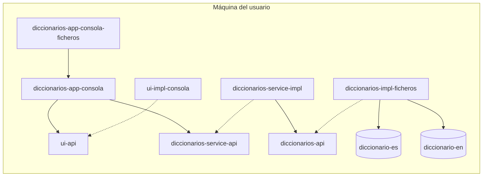

# Diccionario · v1.0: Consola con ficheros

> Rama `v1.0-consola-ficheros`. El proyecto evoluciona rama a rama, y cada una compila, pasa sus
> pruebas y funciona:
>
> **`v1.0-consola-ficheros`** ← estás aquí → `v1.1-control-de-configuracion` → `v1.2-repositorio-que-avisa-de-errores` → `v2.0-servidor-central` → `v3.0-bbdd` → `v3.1-sugerencias` → `v4.0-frontal-web`

Busca una palabra en el diccionario de un idioma y muestra sus significados con ejemplos.

```
$ buscarPalabra es MELON
La palabra melón existe en el idioma ES y tiene los siguientes significados:
- Fruto grande, redondo y de pulpa jugosa y dulce.
    Ej: Me gusta comer melón!
- Persona con pocas luces.
    Ej: Eres un melón
    Ej: No seas melón
```

## Qué trae esta versión

La primera versión que funciona: una app de consola con los diccionarios en ficheros. Y ya en
componentes desacoplados, para que cuando lleguen cambios (y llegarán) no haya que **modificar ni
una línea de código**: crear piezas nuevas, quitar las que sobren, pero no tocar lo que funciona.

- **El repositorio** (`diccionarios-api` + `diccionarios-impl-ficheros`): LÓGICA DE PERSISTENCIA.
  Funciones de muy bajo nivel: `getDiccionario(idioma)`, `getSignificados(palabra)`, `getPalabras()`.
  `Optional` en lugar de `null`. Con sus **pruebas de contrato**: lo que *cualquier* implementación
  tiene que cumplir.
- **El servicio de búsqueda** (`diccionarios-service-api` + `-impl`): LÓGICA DE NEGOCIO, no un
  agregado del repositorio. `buscarExacta` y `buscarIgnorandoMayusculasYAcentos` (*MEMBRILLO* →
  *membrillo*, *Atun* → *atún*; pero *ano* no es *año*). Devuelve tres resultados distintos, y no un
  `Optional` (que no diría si falta la palabra o el idioma): un **`sealed interface
  ResultadoDeBusqueda permits PalabraEncontrada, PalabraNoEncontrada, IdiomaNoSoportado`**, tres
  `record`. Un contrato cerrado (Liskov).
- **La interfaz de usuario, aparte** (`ui-api` / `ui-impl-consola`).
- **Los diccionarios, cada uno su módulo** (`diccionario-es`, `diccionario-en`): independientes entre
  sí y del resto. Los mantienen lingüistas, no desarrolladores.
- **La aplicación**, el ensamblado: `diccionarios-app-consola` es el código (el `main`, las
  **factorías** y el procesador, que trata el resultado con un **`switch` con patrones de Java 21**,
  exhaustivo y sin `default`), y `diccionarios-app-consola-ficheros` es lo que se entrega: un pom sin
  código que dice qué piezas, y en qué versión, lleva.
- Las factorías no hacen el `new` de nada: se lo piden al **`ServiceLoader`** (`uses` / `provides` en
  `module-info.java`), que da lo que haya en el module path.

Y funciona. Pero se instala en cada máquina: cada errata en un diccionario, cada cambio, obliga a
que todos los usuarios actualicen.

Siguiente: `v1.1-control-de-configuracion`.

## Requisitos

- JDK 21 o superior (se compila con `release 21`; probado con JDK 25).
- Maven no hace falta: va el wrapper (`./mvnw`).

## Arquitectura



### Componentes

Cada componente versiona por su cuenta: el número cambia solo cuando cambia él. La tercera
columna dice qué ha cambiado respecto a la rama anterior.

| Componente | Versión | | Qué es |
|---|---|---|---|
| `diccionarios-api` | 1.0.0 |  | El REPOSITORIO (lógica de persistencia): `SuministradorDeDiccionarios`, `Diccionario`, `Significado`. Funciones de bajo nivel, casi un SELECT. Con sus pruebas de contrato (`test-jar`) |
| `diccionarios-impl-ficheros` | 1.0.0 |  | El repositorio en ficheros: lee los `.txt` de los jars de idioma |
| `diccionario-es` | 1.0.0 |  | Solo datos: el diccionario de español y su índice |
| `diccionario-en` | 1.0.0 |  | Solo datos: el diccionario de inglés y su índice |
| `diccionarios-service-api` | 1.0.0 |  | El SERVICIO (lógica de negocio): `BuscadorDePalabras` y su resultado sellado `ResultadoDeBusqueda` (`PalabraEncontrada`, `PalabraNoEncontrada`, `IdiomaNoSoportado`) |
| `diccionarios-service-impl` | 1.0.0 |  | El servicio de verdad, sobre el repositorio. Con las pruebas de contrato del servicio (`test-jar`) |
| `ui-api` | 1.0.0 |  | La interfaz de usuario: todo lo que la app le dice o le pide al usuario |
| `ui-impl-consola` | 1.0.0 |  | La de línea de comandos: lee idioma y palabra de los argumentos |
| `diccionarios-app-consola` | 1.0.0 |  | El código de la app de consola: el `main`, las **factorías** y `ProcesadorDePeticiones`, que expone el servicio por la línea de comandos |
| `diccionarios-app-consola-ficheros` | 1.0.0 |  | LA APLICACIÓN, el ensamblado: un pom sin código que dice qué piezas lleva. Todo en local, con ficheros |

## Comandos

Todo desde esta carpeta (`proyectos/diccionario`). Con el **Maven wrapper** no hace falta tener
Maven instalado: `./mvnw` (en Windows, `mvnw.cmd`) se baja la versión que toca la primera vez.

```bash
./mvnw install                 # todo: compila, pasa las pruebas y deja los jars en target/ y en ~/.m2
./mvnw install -DskipTests     # lo mismo sin pruebas
./mvnw verify                  # pruebas + informe de cobertura (target/site/jacoco/index.html de cada módulo)
```

> `mvn clean` borra el `target/` de un proceso que esté corriendo (el servidor, por ejemplo): la
> JVM sigue viva pero no puede cargar clases nuevas y deja de responder sin decir nada. Reinícialo
> después de cada `clean`.

### La consola, todo en local: `diccionarios-app-consola-ficheros`

```bash
./mvnw install -DskipTests
./mvnw exec:exec -pl diccionarios-app-consola-ficheros -Dargumentos="es MEMBRILLO"
```

Con `java` directamente (después de `./mvnw package`), con las piezas que dice su pom:

```bash
java --module-path diccionarios-api/target/diccionarios-api-1.0.0.jar:diccionarios-service-api/target/diccionarios-service-api-1.0.0.jar:diccionarios-service-impl/target/diccionarios-service-impl-1.0.0.jar:ui-api/target/ui-api-1.0.0.jar:ui-impl-consola/target/ui-impl-consola-1.0.0.jar:diccionarios-impl-ficheros/target/diccionarios-impl-ficheros-1.0.0.jar:diccionario-es/target/diccionario-es-1.0.0.jar:diccionario-en/target/diccionario-en-1.0.0.jar:diccionarios-app-consola/target/diccionarios-app-consola-1.0.0.jar \
     --add-modules ALL-MODULE-PATH \
     --module app/com.curso.diccionario.app.consola.BuscarPalabra es MEMBRILLO
```

- `--add-modules ALL-MODULE-PATH`: las implementaciones y los diccionarios no los requiere ningún
  módulo (se encuentran por el `ServiceLoader` y por el class loader), y un módulo que nadie
  requiere no se carga.
- Quitar un idioma es quitar su jar del module path. No hay nada más que configurar.
- Con `DICCIONARIOS_CARPETA=/ruta/` se leen los `<idioma>.txt` de una carpeta del disco.
- En Windows el separador del *module path* es `;` en lugar de `:`.

## Los diccionarios

Un jar por idioma (`diccionario-es`, `diccionario-en`), con dos ficheros en `META-INF/diccionarios/`:

- `<idioma>.txt`, en UTF-8, una línea por palabra:

  ```
  palabra=significado1(ejemplo1)(ejemplo2)|significado2(ejemplo1)|significado3
  ```

  Los caracteres `=`, `|`, `(` y `)` están reservados: el formato no los escapa.

- `idiomas`: el código del idioma (`ES`). Dentro de un jar no se puede listar una carpeta, pero
  `ClassLoader.getResources` (en plural) devuelve **todos** los `idiomas` del classpath: los idiomas
  disponibles son, por construcción, los jars que hay.

Cada uno tiene unas pocas palabras reales escritas a mano y **5000 inventadas**, las mismas en los
dos idiomas: no hay de dónde sacar 5000 palabras reales con definición y traducción con licencia
para copiarlas. Las genera, siempre iguales, `herramientas/GeneradorDeDiccionarios.java`.

## Cómo evolucionan los API

Todo en 1.0.0. Más adelante el repositorio y el servicio cambiarán **sin romper a nadie**.

## Pruebas

| Dónde | Qué prueban |
|---|---|
| `diccionarios-api` | El **contrato del repositorio**: lo que cualquier implementación tiene que cumplir (`test-jar`). Lo cumple una implementación de referencia en memoria |
| `diccionarios-impl-ficheros` | El contrato del repositorio, con ficheros generados; el formato; la lectura del classpath y del índice |
| `diccionarios-service-impl` | El **contrato del servicio** (`test-jar`): las dos búsquedas, la ñ, los tres resultados; las reglas de normalización |
| `ui-impl-consola`, `diccionarios-app-consola` | Los mensajes de la consola; el procesador con un servicio y una interfaz de usuario falsos, sin capturar la consola |

## Limitaciones conocidas

- **Diccionarios de mentira.** Las 5000 palabras de cada idioma son inventadas, y se nota.
- **Sin acentos, si dos palabras se escriben igual** (*papa* y *papá*) y se busca *PAPA*, se encuentra la primera en orden alfabético. La exacta no tiene ese problema.
- **Los errores no llegan a quien pregunta.** El repositorio 1.0.0 no tiene por dónde decirlo: un fichero ilegible parece *"no existe"*. Lo arregla la `v1.2`.
- **Solo module path** para las apps de consola: en el classpath el `ServiceLoader` no usa los `provides` de `module-info`.

## Novedades de Java 8+ en este código

Lo que este código usa de cada versión LTS (y de las intermedias que llegaron a ellas). En el
código, cada una está marcada la primera vez que aparece en cada fichero con un comentario
`// Java N: ...` que dice qué es; aquí, dónde mirar y la referencia oficial (el JEP de OpenJDK que
la introdujo o, si no tiene, su Javadoc).

| Versión | Novedad | Referencia | Dónde se usa |
|---|---|---|---|
| Java 8 | Expresiones lambda | [JEP 126](https://openjdk.org/jeps/126) | [BuscadorDePalabrasFactory.java:22](diccionarios-app-consola/src/main/java/com/curso/diccionario/app/consola/factorias/BuscadorDePalabrasFactory.java#L22), [InterfazDeUsuarioFactory.java:20](diccionarios-app-consola/src/main/java/com/curso/diccionario/app/consola/factorias/InterfazDeUsuarioFactory.java#L20), [SuministradorDeDiccionariosDesdeFicheros.java:99](diccionarios-impl-ficheros/src/main/java/com/curso/diccionario/impl/ficheros/SuministradorDeDiccionariosDesdeFicheros.java#L99), y 4 más |
| Java 8 | Referencias a método (`::`) | [JEP 126](https://openjdk.org/jeps/126) | [CatalogoDeDiccionariosEnClasspath.java:45](diccionarios-impl-ficheros/src/main/java/com/curso/diccionario/impl/ficheros/formato/CatalogoDeDiccionariosEnClasspath.java#L45) |
| Java 8 | Streams (`stream`, `map`, `filter`, `parallelStream`...) | [JEP 107](https://openjdk.org/jeps/107) | [SuministradorDeDiccionariosDesdeFicheros.java:97](diccionarios-impl-ficheros/src/main/java/com/curso/diccionario/impl/ficheros/SuministradorDeDiccionariosDesdeFicheros.java#L97), [CatalogoDeDiccionariosEnClasspath.java:41](diccionarios-impl-ficheros/src/main/java/com/curso/diccionario/impl/ficheros/formato/CatalogoDeDiccionariosEnClasspath.java#L41), [FormatoDeFicheroDeDiccionario.java:41](diccionarios-impl-ficheros/src/main/java/com/curso/diccionario/impl/ficheros/formato/FormatoDeFicheroDeDiccionario.java#L41), y 1 más |
| Java 8 | `Optional` | [`Optional`](https://docs.oracle.com/en/java/javase/21/docs/api/java.base/java/util/Optional.html) | [Diccionario.java:16](diccionarios-api/src/main/java/com/curso/diccionario/api/Diccionario.java#L16), [SuministradorDeDiccionarios.java:17](diccionarios-api/src/main/java/com/curso/diccionario/api/SuministradorDeDiccionarios.java#L17), [ProcesadorDePeticiones.java:34](diccionarios-app-consola/src/main/java/com/curso/diccionario/app/consola/ProcesadorDePeticiones.java#L34), y 6 más |
| Java 9 | Módulos (`module-info.java`: `requires`, `exports`, `uses`, `provides`) | [JEP 261](https://openjdk.org/jeps/261) | [module-info.java:2](diccionarios-api/src/main/java/module-info.java#L2), [module-info.java:2](diccionarios-app-consola/src/main/java/module-info.java#L2), [module-info.java:2](diccionarios-impl-ficheros/src/main/java/module-info.java#L2), y 4 más |
| Java 9 | `ServiceLoader` sobre módulos (`uses` / `provides`) | [`ServiceLoader`](https://docs.oracle.com/en/java/javase/21/docs/api/java.base/java/util/ServiceLoader.html) | [BuscadorDePalabrasFactory.java:14](diccionarios-app-consola/src/main/java/com/curso/diccionario/app/consola/factorias/BuscadorDePalabrasFactory.java#L14), [InterfazDeUsuarioFactory.java:12](diccionarios-app-consola/src/main/java/com/curso/diccionario/app/consola/factorias/InterfazDeUsuarioFactory.java#L12), [SuministradorDeDiccionariosDesdeFicheros.java:63](diccionarios-impl-ficheros/src/main/java/com/curso/diccionario/impl/ficheros/SuministradorDeDiccionariosDesdeFicheros.java#L63), y 6 más |
| Java 9 | `List.of` / `Map.of` / `Set.of` | [JEP 269](https://openjdk.org/jeps/269) | [InterfazDeUsuarioFactory.java:22](diccionarios-app-consola/src/main/java/com/curso/diccionario/app/consola/factorias/InterfazDeUsuarioFactory.java#L22), [SuministradorDeDiccionariosDesdeFicheros.java:86](diccionarios-impl-ficheros/src/main/java/com/curso/diccionario/impl/ficheros/SuministradorDeDiccionariosDesdeFicheros.java#L86) |
| Java 9 | `InputStream.readAllBytes()` | [`InputStream.readAllBytes`](https://docs.oracle.com/en/java/javase/21/docs/api/java.base/java/io/InputStream.html#readAllBytes()) | [FormatoDeFicheroDeDiccionario.java:29](diccionarios-impl-ficheros/src/main/java/com/curso/diccionario/impl/ficheros/formato/FormatoDeFicheroDeDiccionario.java#L29), [FicherosDePruebaTest.java:83](diccionarios-impl-ficheros/src/test/java/com/curso/diccionario/impl/ficheros/FicherosDePruebaTest.java#L83) |
| Java 10 | `List.copyOf` / `Map.copyOf` | [`List.copyOf`](https://docs.oracle.com/en/java/javase/21/docs/api/java.base/java/util/List.html#copyOf(java.util.Collection)) | [DiccionarioDesdeFichero.java:39](diccionarios-impl-ficheros/src/main/java/com/curso/diccionario/impl/ficheros/DiccionarioDesdeFichero.java#L39), [PalabraEncontrada.java:26](diccionarios-service-api/src/main/java/com/curso/diccionario/service/api/PalabraEncontrada.java#L26), [InterfazDeUsuarioPorArgumentos.java:20](ui-impl-consola/src/main/java/com/curso/diccionario/ui/consola/argumentos/InterfazDeUsuarioPorArgumentos.java#L20), y 5 más |
| Java 11 | Métodos nuevos de `String` (`strip`, `isBlank`, `lines`, `repeat`) | [`String`](https://docs.oracle.com/en/java/javase/21/docs/api/java.base/java/lang/String.html#strip()) | [CatalogoDeDiccionariosEnClasspath.java:68](diccionarios-impl-ficheros/src/main/java/com/curso/diccionario/impl/ficheros/formato/CatalogoDeDiccionariosEnClasspath.java#L68), [FormatoDeFicheroDeDiccionario.java:40](diccionarios-impl-ficheros/src/main/java/com/curso/diccionario/impl/ficheros/formato/FormatoDeFicheroDeDiccionario.java#L40), [BuscadorDePalabrasEnDiccionarios.java:109](diccionarios-service-impl/src/main/java/com/curso/diccionario/service/impl/BuscadorDePalabrasEnDiccionarios.java#L109), y 2 más |
| Java 11 | `Path.of`, `Files.readString` / `writeString` | [`Path.of`](https://docs.oracle.com/en/java/javase/21/docs/api/java.base/java/nio/file/Path.html#of(java.lang.String,java.lang.String...)) | [SuministradorDeDiccionariosDesdeFicheros.java:92](diccionarios-impl-ficheros/src/main/java/com/curso/diccionario/impl/ficheros/SuministradorDeDiccionariosDesdeFicheros.java#L92) |
| Java 15 | Bloques de texto (`"""`) | [JEP 378](https://openjdk.org/jeps/378) | [InterfazDeUsuarioPorArgumentos.java:59](ui-impl-consola/src/main/java/com/curso/diccionario/ui/consola/argumentos/InterfazDeUsuarioPorArgumentos.java#L59), [InterfazDeUsuarioPorArgumentosTest.java:61](ui-impl-consola/src/test/java/com/curso/diccionario/ui/consola/argumentos/InterfazDeUsuarioPorArgumentosTest.java#L61) |
| Java 16 | `record` | [JEP 395](https://openjdk.org/jeps/395) | [SignificadoDesdeFichero.java:8](diccionarios-impl-ficheros/src/main/java/com/curso/diccionario/impl/ficheros/formato/SignificadoDesdeFichero.java#L8), [IdiomaNoSoportado.java:8](diccionarios-service-api/src/main/java/com/curso/diccionario/service/api/IdiomaNoSoportado.java#L8), [PalabraEncontrada.java:17](diccionarios-service-api/src/main/java/com/curso/diccionario/service/api/PalabraEncontrada.java#L17), y 6 más |
| Java 16 | `Stream.toList()` | [`Stream.toList`](https://docs.oracle.com/en/java/javase/21/docs/api/java.base/java/util/stream/Stream.html#toList()) | [SuministradorDeDiccionariosDesdeFicheros.java:104](diccionarios-impl-ficheros/src/main/java/com/curso/diccionario/impl/ficheros/SuministradorDeDiccionariosDesdeFicheros.java#L104), [CatalogoDeDiccionariosEnClasspath.java:52](diccionarios-impl-ficheros/src/main/java/com/curso/diccionario/impl/ficheros/formato/CatalogoDeDiccionariosEnClasspath.java#L52), [FormatoDeFicheroDeDiccionario.java:40](diccionarios-impl-ficheros/src/main/java/com/curso/diccionario/impl/ficheros/formato/FormatoDeFicheroDeDiccionario.java#L40) |
| Java 17 | Clases e interfaces selladas (`sealed` / `permits`) | [JEP 409](https://openjdk.org/jeps/409) | [ResultadoDeBusqueda.java:75](diccionarios-service-api/src/main/java/com/curso/diccionario/service/api/ResultadoDeBusqueda.java#L75) |
| Java 21 | `switch` con patrones | [JEP 441](https://openjdk.org/jeps/441) | [ProcesadorDePeticiones.java:57](diccionarios-app-consola/src/main/java/com/curso/diccionario/app/consola/ProcesadorDePeticiones.java#L57) |
| Java 21 | Patrones de `record` (*record patterns*) | [JEP 440](https://openjdk.org/jeps/440) | [ProcesadorDePeticiones.java:59](diccionarios-app-consola/src/main/java/com/curso/diccionario/app/consola/ProcesadorDePeticiones.java#L59) |
